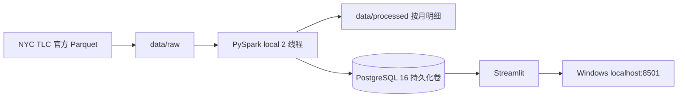
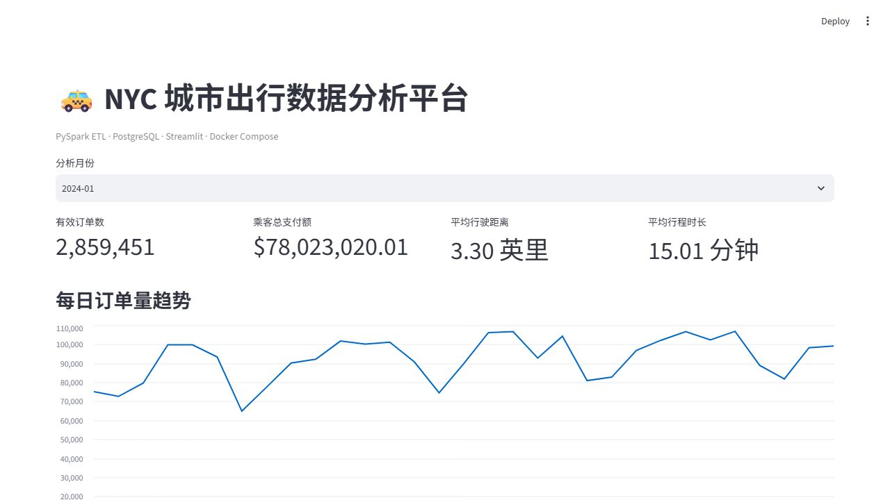
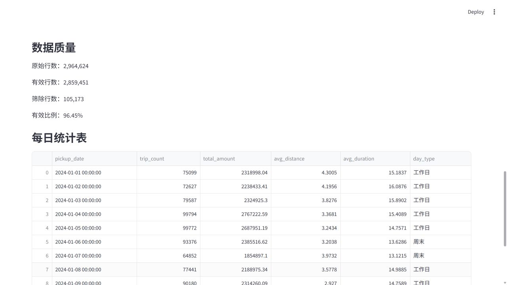
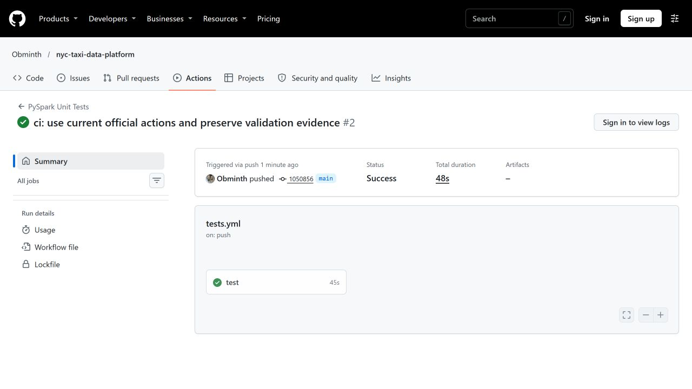

# NYC Taxi Data Analytics Platform

[](https://github.com/Obminth/nyc-taxi-data-platform/actions/workflows/tests.yml)

基于 PySpark、PostgreSQL、Streamlit 和 Docker Compose 的城市出行数据平台。使用 NYC TLC 2024 年 1 月 Yellow Taxi 公开数据，完成读取、清洗、Parquet 明细保存、SQL 汇总与交互式分析，并练习单机容器运维。

## 业务问题与项目目标

分析每天和各小时的有效订单分布、工作日与周末的日均订单差异，以及样本中的支付额、距离和时长。通过清洗规则、执行记录和 SQL 对账，确保看板指标有可追溯的统计口径。

## 技术栈与架构

Python 3.12 · PySpark 4.2.1 · PostgreSQL 16 · psycopg2 · Streamlit · pandas · pytest · Docker Compose · WSL2 Ubuntu 24.04。PySpark 版本固定，其余 Python 依赖范围见 requirements 文件；不是所有依赖都已锁定到精确版本。



`db`、`dashboard` 常驻运行；`etl` 属于 `tools` profile，按需运行后退出。容器间通过 `db:5432` 连接，数据库未向宿主机映射端口；看板仅绑定 `127.0.0.1:8501`。代码位于 WSL Linux 文件系统。

## 数据来源

[NYC TLC Trip Record Data 官方页面](https://www.nyc.gov/site/tlc/about/tlc-trip-record-data.page)。本项目使用 Yellow Taxi 2024 年 1 月文件；数据归原发布方，使用条件以官方页面为准。

本机文件大小为 49,961,641 字节，SHA-256 为：

```text
c4d59da7bbc8abaeeeb1727947ee93d9891a71acb42854bd80db1571b2030510
```

此哈希为本机文件指纹，未与发布方校验值比对。原始数据、处理明细和数据库卷不提交到 Git。

## 目录说明

```text
nyc-taxi-data-platform/
├── docker-compose.yml         # 数据库、ETL、看板编排
├── .env.example               # 环境变量示例，不含真实密码
├── docker/etl.Dockerfile      # Python 与 Java ETL 环境
├── requirements-etl.txt
├── src/transform.py           # 清洗函数
├── src/etl.py                 # 批处理及数据库写入
├── sql/init.sql               # 首次初始化建表
├── sql/verify.sql             # 只读数据一致性核验
├── dashboard/                 # 看板代码、依赖与 Dockerfile
├── tests/test_transform.py
├── data/raw/                  # 原始 Parquet（忽略）
├── data/processed/            # 清洗明细（忽略）
└── docs/
    ├── analysis-report.md     # 真实数据分析及口径
    ├── troubleshooting.md     # 已有故障记录和恢复复测
    ├── project-audit.md       # 指导书第一版验收状态
    └── screenshots/           # 本机实际运行截图
```

## 从零运行

以下命令在 **WSL Ubuntu** 的项目根目录执行。先安装 Docker Desktop 并启用 Ubuntu 的 WSL Integration，确认 `docker version` 同时显示 Client 和 Server。已有部署可直接使用“检查现有部署”一节。

```bash
cd ~/projects/nyc-taxi-data-platform
mkdir -p data/raw data/processed
# 仅首次创建；已有 .env 时保留原配置
if [ ! -f .env ]; then cp .env.example .env; fi
nano .env
```

将 `.env` 中的 `DB_PASSWORD` 换成自己的强密码。`.env` 为逐行 `KEY=VALUE` 格式，不添加 `[ini]`。已有数据库卷时，修改环境变量不会自动修改库中用户密码，须按既有数据库配置连接或单独迁移密码。

若原始文件尚不存在，下载：

```bash
curl -fL --retry 3 \
  'https://d37ci6vzurychx.cloudfront.net/trip-data/yellow_tripdata_2024-01.parquet' \
  -o data/raw/yellow_tripdata_2024-01.parquet
ls -lh data/raw/yellow_tripdata_2024-01.parquet
sha256sum data/raw/yellow_tripdata_2024-01.parquet
```

构建并运行：

```bash
docker compose up -d db
docker compose build etl dashboard
docker compose run --rm etl
docker compose up -d dashboard
docker compose ps
```

Windows 浏览器访问 [本机看板](http://localhost:8501)。默认月份和输入文件均为 `2024-01`。其他月份需同时指定参数，例如 `docker compose run --rm etl python -m src.etl --month 2024-02 --input data/raw/yellow_tripdata_2024-02.parquet`，并先准备对应文件。

`sql/init.sql` 仅在 PostgreSQL 空数据目录首次初始化时自动执行。已有卷不会因修改该文件而自动更新表结构，历史字段问题见[排障记录](docs/troubleshooting.md)。

## 检查现有部署与测试

```bash
docker compose ps -a
docker compose logs --tail=100 db dashboard
docker compose run --rm etl python -m pytest -q
docker compose exec -T db sh -c 'psql -v ON_ERROR_STOP=1 -U "$POSTGRES_USER" -d "$POSTGRES_DB"' < sql/verify.sql
curl -fsS http://localhost:8501/_stcore/health
```

`verify.sql` 目前核验 2024 年 1 月；末行各一致性标志应为 `t`。单元测试覆盖正常记录、零距离、跨月记录和缺少必需字段。健康接口只证明 Web 服务响应，不能代替数据库数据核验或浏览器检查。

## 清洗规则与指标口径

| 项目 | 规则或含义 |
| --- | --- |
| 必需字段 | 上车时间、下车时间、距离、总支付额；缺列抛出 ValueError |
| 月份 | 上车时间位于月初（含）至下月月初（不含） |
| 时间与时长 | 上下车时间非空；时长 1～240 分钟，包含端点 |
| 距离 | 0.1～100 英里，包含端点 |
| 支付额 | 0.01～500 美元，包含端点 |
| 时间口径 | Spark 会话时区为 America/New_York |
| 平均距离与时长 | 用每日订单量加权，不能直接对每日均值再次取平均 |
| 工作日与周末 | 周一至周五与周六、周日；比较各组日均订单，不按节假日另分类 |
| 有效比例 | clean_rows / source_rows；筛除总数不能直接解释为坏数据率 |

阈值是教学假设，不是 TLC 官方质量标准。代码没有去重，也没有统计每条清洗规则分别筛除了多少行。`total_amount` 是源字段总支付额，不能解释为企业净利润。

`daily_metrics` 按日期汇总，`hourly_metrics` 按月份和小时汇总，`etl_runs` 追加成功执行记录。同月重跑会在一个 PostgreSQL 事务内删除旧汇总、写入新汇总并追加执行记录；Parquet 按月覆盖。不能把多次 `etl_runs` 的行数相加当作独立数据规模。

## 本机实际核验结果

2026-11-01（香港时间）完成完整 ETL 重跑、六次正式性能测量、数据库对账、看板与 CSV 下载验证，结果如下。

| 指标 | 实测值 |
| --- | ---: |
| 原始行数 | 2,964,624 |
| 有效行数 | 2,859,451 |
| 筛除行数 | 105,173 |
| 有效比例 | 96.45% |
| 日汇总 / 小时汇总行数 | 31 / 24 |
| 日、小时汇总订单数 | 均为 2,859,451 |
| 样本总支付额 | $78,023,020.01 |
| 订单加权平均距离 | 3.30 英里 |
| 订单加权平均时长 | 15.01 分钟 |
| pytest | 2 passed in 11.42s |

已验证 `原始 = 有效 + 筛除` 且 `有效 = 日汇总 = 小时汇总`，日、小时支付额也一致。Streamlit AppTest 四个核心指标无异常，浏览器已核验图表；实际下载 CSV 为 31 行，合计订单数 2,859,451、支付额 $78,023,020.01。看板停服时连接失败，启动后恢复。

local[2] 三次端到端平均 **16.338 秒**，local[4] 平均 **14.908 秒**，本轮后者低约 **8.75%**。这是单机、预热缓存、每组 3 次的观察，不能外推为普遍性能收益。完整方法和原始记录见[性能报告](docs/performance-report.md)。

详见[分析报告](docs/analysis-report.md)、[项目核对清单](docs/project-audit.md)及 [GitHub Actions](https://github.com/Obminth/nyc-taxi-data-platform/actions)。CI 仅运行测试数据的 PySpark 单元测试，不部署系统，也不读取真实 TLC 数据。

## 示例截图

以下为本机真实运行截图；完整命令输出保存在 [docs/evidence](docs/evidence)。更新后的 [GitHub Actions 已通过](https://github.com/Obminth/nyc-taxi-data-platform/actions/runs/41229546426)，远程 pytest 同样为 2 passed。





停服恢复截图见 [dashboard-restored.png](docs/screenshots/dashboard-restored.png)。pytest、Compose、SQL 对账原始输出分别见 [pytest.txt](docs/evidence/pytest.txt)、[compose-status.txt](docs/evidence/compose-status.txt)、[sql-verification.txt](docs/evidence/sql-verification.txt)。



pytest、SQL 与 Compose 原始输出的 GitHub 页面截图见 [pytest-record.png](docs/screenshots/pytest-record.png)、[sql-record.png](docs/screenshots/sql-record.png)、[compose-record.png](docs/screenshots/compose-record.png)。

## 运维与局限

排查顺序：容器状态 → 日志 → 数据库表结构及汇总 → 看板页面。看板 SQL 查询缓存为 60 秒，数据库停服后短时间仍有图表不代表数据库健康。日常可用 `docker stats --no-stream`、`docker system df`、`df -h /` 和 Windows 的 `Get-PSDrive` 分别检查资源。

- Spark 默认使用 `local[2]`，不是多节点分布式集群；可通过 `--spark-master` 选择 local[2] 或 local[4]。
- Parquet 与 PostgreSQL 之间没有跨系统原子事务；失败时可能只更新了 Parquet，需对照日志和数据库确认。
- 当前为单月、单机教学项目；无区域维度、调度、生产级告警或高可用。
- pytest 范围有限，不等于已覆盖真实数据库集成或所有边界情况。

## 许可证与致谢

感谢 NYC TLC 提供公开数据，以及各开源组件的贡献者。本仓库代码采用 [MIT License](LICENSE)。数据使用条件与代码许可证分别遵循各自说明。
